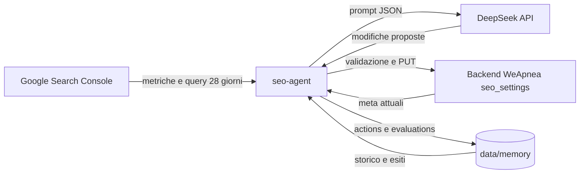

# SEO Agent – WeApnea

Tool automatico che analizza le performance SEO del sito WeApnea, decide quali meta tag modificare (title e description per pagina e per lingua), applica le modifiche e poi misura se hanno funzionato, salvando tutto in una memoria storica.

## Obiettivo

1. Leggere i dati di performance da **Google Search Console** (clic, impressioni, CTR, posizione, query).
2. Chiedere a **DeepSeek** di proporre modifiche ai meta tag, passando dati attuali e storico.
3. Applicare le modifiche tramite l'API admin del backend (`PUT /api/admin/seo-settings`).
4. Valutare dopo qualche settimana se la modifica ha migliorato o peggiorato i risultati.
5. Salvare l'esito in una **memoria storica**, così le decisioni successive tengono conto di ciò che ha funzionato e di ciò che non ha funzionato.

## Come funziona



Il ciclo è composto da tre comandi:

- `run`: raccoglie i dati, chiede a DeepSeek le modifiche, le valida e le mostra. Con `--apply` le scrive davvero. Senza `--apply` è un dry-run e salva solo una proposta.
- `evaluate`: per ogni modifica applicata da almeno `SEO_EVAL_DAYS` giorni confronta le metriche prima e dopo, assegna un verdetto (`migliorato`, `peggiorato`, `neutro`, `dati-insufficienti`) e chiede a DeepSeek una lezione sintetica. Con `SEO_AUTO_ROLLBACK=true` (default) ripristina i valori precedenti in caso di peggioramento, salvo che la pagina abbia modifiche successive.
- `history`: stampa lo storico delle modifiche con esito e lezione.
- `report`: andamento a 28 giorni e 12 settimane, esiti delle modifiche e controlli tecnici (sitemap e indicizzazione delle pagine statiche).

### Come decide se una modifica è giusta o sbagliata

Il verdetto è calcolato con regole sulle metriche, non dal modello:

| Verdetto             | Regola                                                                                                 |
| -------------------- | ------------------------------------------------------------------------------------------------------ |
| `dati-insufficienti` | meno di 60 impressioni complessive nei due periodi (`SEO_MIN_IMPRESSIONS`, default 30 per periodo)    |
| `peggiorato`         | clic in calo di oltre il 15% (con almeno 10 clic prima) oppure posizione media peggiorata di oltre 1,5 |
| `migliorato`         | clic in crescita di oltre il 15% (e almeno 3 clic in più) oppure posizione migliorata di oltre 1,5     |
| `neutro`             | nessuna delle condizioni sopra                                                                         |

DeepSeek riceve metriche e verdetto e scrive una lezione (`was_right` e `lesson`). Questa lezione torna nei prompt successivi insieme allo storico della pagina, così il modello evita di ripetere approcci già falliti.

Nei prompt di decisione ogni pagina riceve anche `ctrExpected` (CTR indicativa per la sua posizione media) e `ctrGap` (differenza in punti percentuali). Un `ctrGap` negativo segnala un titolo che non attira clic rispetto alla posizione occupata. La tabella di riferimento è una stima generica, non dati del sito.

**Limite importante:** la correlazione non è causalità. Stagionalità, aggiornamenti di Google o altri contenuti possono cambiare i numeri senza che il meta tag c'entri. Per questo il periodo di valutazione è di 21 giorni per default e il tool non applica modifiche automatiche senza `--apply`.

## Come si integra con il sito

- Le pagine statiche leggono title e description dalla tabella `seo_settings` tramite `GET /api/public/seo-settings` (vedi [PageHead.tsx](../src/components/PageHead.tsx) e [useSeoSettings.ts](../src/hooks/useSeoSettings.ts)).
- Le traduzioni sono salvate nel campo `translations` per lingua. L'italiano è nei campi `title` e `description`.
- Il backend espone `GET` e `PUT /api/admin/seo-settings`, protetti da `Authorization: Bearer <API_TOKEN>`.
- Il title non deve includere il brand "WeApnea", perché `PageHead` lo aggiunge in automatico.
- Le modifiche sono visibili subito nel frontend (cache di 10 minuti nel client). I bot ricevono i meta tramite `/api/seo-meta`.

## Struttura della cartella

```
seo-agent/
  README.md            questa documentazione
  package.json         script npm (nessuna dipendenza esterna)
  .env.example         variabili di configurazione
  .gitignore           esclude .env, secrets/, data/proposals/
  src/
    index.mjs          CLI: run, evaluate, history
    agent.mjs          logica: raccolta, decisione, validazione, applicazione, valutazione
    technical.mjs      controlli tecnici: sitemap e URL Inspection su Search Console
    prompt.mjs         prompt per DeepSeek (decisione e valutazione)
    google.mjs         client Search Console (autenticazione service account)
    deepseek.mjs       client DeepSeek (output JSON)
    site-api.mjs       client API admin del backend
    memory.mjs         memoria storica su file JSONL
    config.mjs         configurazione da variabili d'ambiente
  data/                creato automaticamente
    memory/
      actions.jsonl       ogni modifica applicata (prima e dopo, motivo, stato)
      evaluations.jsonl   esito di ogni modifica (metriche, verdetto, lezione)
    proposals/            proposte di ogni run (anche dry-run), per audit
```

## Setup

Requisiti: Node.js 20.6 o superiore (usa `--env-file`). Nessuna dipendenza da installare.

1. **Google Search Console**
   - In Google Cloud crea un progetto, abilita la _Search Console API_ e crea un _service account_.
   - Scarica la chiave JSON e salvala in `seo-agent/secrets/service-account.json`.
   - In Search Console, nella property del sito, aggiungi l'email del service account come utente con permesso di lettura.
2. **DeepSeek**: crea una API key su platform.deepseek.com.
3. **Backend**: usa lo stesso valore di `API_TOKEN` impostato su Render.
4. Copia `.env.example` in `.env` e compila i valori.

## Comandi

Eseguili dalla cartella `seo-agent`:

```bash
npm run run        # dry-run: analizza e salva una proposta, non modifica nulla
npm run apply      # applica le modifiche proposte
npm run evaluate   # valuta le modifiche applicate abbastanza vecchie
npm run history    # storico con esiti
```

Consiglio: esegui prima `npm run run` e controlla la proposta in `data/proposals/`. Passa ad `apply` solo quando i risultati ti convincono.

## Sicurezza e controlli

- **Dry-run di default**: senza `--apply` non scrive nulla sul sito.
- **Allow-list**: il tool modifica solo i path in `SEO_ALLOWED_PATHS` e solo i campi `title` e `description`.
- **Validazione**: lunghezze (title 20–60, description 50–160), lingue supportate, valori non vuoti e diversi dall'attuale. Le modifiche scartate compaiono nella proposta con il motivo.
- **Limite per run**: massimo `SEO_MAX_CHANGES_PER_RUN` modifiche (default 5), contate su tutti i gruppi insieme. Il resto dei target passa al run successivo.
- **Soglia di dati**: nessuna modifica per pagine con poche impressioni (il prompt lo impone, la valutazione lo richiede).
- **Rollback**: attivo di default (`SEO_AUTO_ROLLBACK=true`). Ripristina i valori precedenti se il verdetto è `peggiorato`. Non ripristina se la pagina ha ricevuto modifiche successive, per non cancellare il lavoro più recente. Imposta `SEO_AUTO_ROLLBACK=false` per la sola revisione manuale.
- **Brand nel title**: un title che contiene "WeApnea" viene scartato, perché il sito lo aggiunge da sé.
- **Segreti**: `.env` e `secrets/` sono nel `.gitignore`. Non committare mai le chiavi.

## Limiti attuali

- Copre le pagine statiche di `seo_settings`, gli articoli del blog (`/blog/<slug>`) e gli eventi (`/<slug>`): tutti salvati in `seo_settings` per path, con traduzioni per eventi e pagine statiche. Ogni run è limitato da `SEO_MAX_CHANGES_PER_RUN` e dal budget di tempo (`SEO_RUN_BUDGET_MINUTES`, default 40); i target rimasti passano al run successivo.
- Non modifica sitemap, robots, og_image, dati strutturati o contenuti delle pagine: solo meta tag. L'unica scrittura sulla sitemap è il reinvio a Search Console (vedi sotto).
- **Reinvio sitemap:** a ogni `cron` il tool reinvia `sitemap.xml` se Google non l'ha riscaricata da più di 3 giorni. Usa lo scope `webmasters` (scrittura), separato dallo scope di sola lettura del resto. Il service account deve avere il permesso Completo sulla proprietà.
- Google Search Console ha un ritardo di 2–3 giorni: il tool usa come ultimo giorno disponibile oggi meno 3.
- La prima valutazione utile arriva dopo circa 3 settimane. Serve tempo per avere campioni significativi.
- Non esegue cron automatici: i comandi vanno lanciati a mano o schedulati (ad esempio con una task pianificata di Windows o un cron sul server).

## Prossimi passi possibili

- Estendere il tool agli articoli del blog (`seo_title`, `seo_description`).
- Schedulare `run` settimanale e `evaluate` mensile.
- Aggiungere una vista di riepilogo nella dashboard admin.
- Integrare dati SEM (Google Ads) per confrontare parole chiave a pagamento e organiche.
