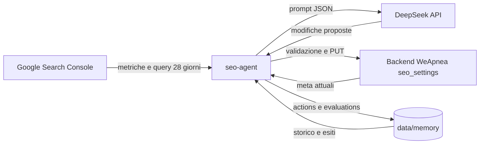

# SEO Agent – WeApnea

Tool automatico che analizza le performance SEO del sito WeApnea, decide quali meta tag modificare (title e description per pagina e per lingua), applica le modifiche e poi misura se hanno funzionato, salvando tutto in una memoria storica.

## Obiettivo

1. Leggere i dati di performance da **Google Search Console** (clic, impressioni, CTR, posizione, query).
2. Chiedere a **DeepSeek** di proporre modifiche ai meta tag, passando dati attuali e storico.
3. Applicare le modifiche tramite l'API admin del backend (`PUT /api/admin/seo-settings`).
4. Valutare dopo qualche settimana se la modifica ha migliorato o peggiorato i risultati.
5. Salvare l'esito in una **memoria storica**, così le decisioni successive tengono conto di ciò che ha funzionato e di ciò che non ha funzionato.

## Come funziona



Il ciclo è composto dai comandi principali (vedi [Comandi](#comandi)). Il workflow GitHub esegue `cron` in automatico: le sezioni collaborano tra loro e inviano un solo messaggio WhatsApp per run (vedi [Automazioni](#automazioni-cron)).

- `run`: raccoglie i dati, chiede a DeepSeek le modifiche, le valida e le mostra. Con `--apply` le scrive davvero. Senza `--apply` è un dry-run e salva solo una proposta.
- `evaluate`: per ogni modifica applicata da almeno `SEO_EVAL_DAYS` giorni confronta le metriche prima e dopo, assegna un verdetto (`migliorato`, `peggiorato`, `neutro`, `dati-insufficienti`) e chiede a DeepSeek una lezione sintetica. Con `SEO_AUTO_ROLLBACK=true` (default) ripristina i valori precedenti in caso di peggioramento, salvo che la pagina abbia modifiche successive.
- `history`: stampa lo storico delle modifiche con esito e lezione.
- `report`: andamento a 28 giorni e 12 settimane, esiti delle modifiche e controlli tecnici (sitemap e indicizzazione delle pagine statiche).

### Come decide se una modifica è giusta o sbagliata

Il verdetto è calcolato con regole sulle metriche, non dal modello:

| Verdetto             | Regola                                                                                                 |
| -------------------- | ------------------------------------------------------------------------------------------------------ |
| `dati-insufficienti` | meno di 60 impressioni complessive nei due periodi (`SEO_MIN_IMPRESSIONS`, default 30 per periodo)    |
| `peggiorato`         | clic in calo di oltre il 15% (con almeno 10 clic prima) oppure posizione media peggiorata di oltre 1,5 |
| `migliorato`         | clic in crescita di oltre il 15% (e almeno 3 clic in più) oppure posizione migliorata di oltre 1,5     |
| `neutro`             | nessuna delle condizioni sopra                                                                         |

DeepSeek riceve metriche e verdetto e scrive una lezione (`was_right` e `lesson`). Questa lezione torna nei prompt successivi insieme allo storico della pagina, così il modello evita di ripetere approcci già falliti.

Nei prompt di decisione ogni pagina riceve anche `ctrExpected` (CTR indicativa per la sua posizione media) e `ctrGap` (differenza in punti percentuali). Un `ctrGap` negativo segnala un titolo che non attira clic rispetto alla posizione occupata. La tabella di riferimento è una stima generica, non dati del sito.

**Limite importante:** la correlazione non è causalità. Stagionalità, aggiornamenti di Google o altri contenuti possono cambiare i numeri senza che il meta tag c'entri. Per questo il periodo di valutazione è di 21 giorni per default e il tool non applica modifiche automatiche senza `--apply`.

## Come si integra con il sito

- Le pagine statiche leggono title e description dalla tabella `seo_settings` tramite `GET /api/public/seo-settings` (vedi [PageHead.tsx](../src/components/PageHead.tsx) e [useSeoSettings.ts](../src/hooks/useSeoSettings.ts)).
- Le traduzioni sono salvate nel campo `translations` per lingua. L'italiano è nei campi `title` e `description`.
- Il backend espone `GET` e `PUT /api/admin/seo-settings`, protetti da `Authorization: Bearer <API_TOKEN>`.
- Il title non deve includere il brand "WeApnea", perché `PageHead` lo aggiunge in automatico.
- Le modifiche sono visibili subito nel frontend (cache di 10 minuti nel client). I bot ricevono i meta tramite `/api/seo-meta`.

## Struttura della cartella

```
seo-agent/
  README.md            questa documentazione
  package.json         script npm (nessuna dipendenza esterna)
  .gitignore           esclude .env, secrets/, data/proposals/, data/cron.log, docs/
  src/
    index.mjs          CLI: run, evaluate, cron, report, monitor, opportunities, history
    agent.mjs          logica: raccolta, decisione, validazione, applicazione, valutazione
    technical.mjs      controlli tecnici: sitemap e URL Inspection su Search Console
    indexnow.mjs       invio URL nuove o cambiate a IndexNow (Bing e altri motori)
    monitor.mjs        controlli tecnici periodici con avvisi WhatsApp per i problemi nuovi
    opportunities.mjs  query vicine alla prima pagina e query contese tra più pagine
    prompt.mjs         prompt per DeepSeek (decisione e valutazione)
    google.mjs         client Search Console (autenticazione service account)
    deepseek.mjs       client DeepSeek (output JSON)
    site-api.mjs       client API admin del backend
    memory.mjs         memoria storica su file JSONL
    config.mjs         configurazione da variabili d'ambiente
  data/                creato automaticamente
    memory/
      actions.jsonl       ogni modifica applicata (prima e dopo, motivo, stato)
      evaluations.jsonl   esito di ogni modifica (metriche, verdetto, lezione)
      sitemap-snapshot.json   lastmod delle URL già notificate a IndexNow
      monitor-state.json      problemi tecnici già segnalati nel gruppo
    proposals/            proposte di ogni run (anche dry-run), per audit
```

## Setup

Requisiti: Node.js 20.6 o superiore (usa `--env-file`). Nessuna dipendenza da installare.

1. **Google Search Console**
   - In Google Cloud crea un progetto, abilita la _Search Console API_ e crea un _service account_.
   - Scarica la chiave JSON e salvala in `seo-agent/secrets/service-account.json`.
   - In Search Console, nella property del sito, aggiungi l'email del service account con permesso **Completo**. Il permesso di sola lettura non basta: il reinvio della sitemap è una scrittura.
2. **DeepSeek**: crea una API key su platform.deepseek.com.
3. **Backend**: usa lo stesso valore di `API_TOKEN` impostato su Render.
4. Crea `seo-agent/.env` con le variabili della tabella sotto. Il file non va committato.
5. **IndexNow** (opzionale ma consigliato): genera una chiave (8–128 caratteri `a-z A-Z 0-9 -`), salvala in `INDEXNOW_KEY` e crea nella cartella `public/` del sito un file `<chiave>.txt` che contiene solo la chiave. Va pubblicato con il sito: finché il file non è online la chiave non è verificabile e IndexNow non può usarla per indicizzare, anche se può accettare la richiesta.
6. **PageSpeed** (opzionale): `PAGESPEED_API_KEY`. Senza chiave le richieste condividono una quota giornaliera che si esaurisce in fretta; in quel caso il monitor avvisa nei log e salta il controllo.

### Variabili d'ambiente

| Variabile                                                 | Obbligatoria per       | Descrizione                                                                             |
| --------------------------------------------------------- | ---------------------- | --------------------------------------------------------------------------------------- |
| `API_TOKEN`                                               | run, cron, sync        | token admin del backend                                                                 |
| `GOOGLE_SERVICE_ACCOUNT_FILE`                             | run, cron, report, monitor, opportunities | percorso della chiave JSON del service account                       |
| `DEEPSEEK_API_KEY`                                        | run, cron, evaluate    | API key DeepSeek                                                                        |
| `API_BASE_URL`, `DEEPSEEK_BASE_URL`, `DEEPSEEK_MODEL`     | no                     | override degli endpoint e del modello                                                   |
| `GSC_SITE_URL`                                            | no                     | proprietà Search Console (default `sc-domain:weapnea.com`)                              |
| `PUBLIC_BASE_URL`                                         | no                     | dominio pubblico usato per sitemap, IndexNow e monitor (default `https://www.weapnea.com`) |
| `INDEXNOW_KEY`                                            | no (IndexNow)          | chiave IndexNow, uguale al nome del file in `public/`                                   |
| `PAGESPEED_API_KEY`                                       | no                     | chiave PageSpeed Insights, evita la quota condivisa                                     |
| `BOT_API_URL`, `BOT_API_TOKEN`, `BOT_GROUP_JID`           | no (avvisi WhatsApp)   | bot WhatsApp e gruppo di destinazione dei recap e degli avvisi                          |
| `SEO_ALLOWED_PATHS`, `SEO_LANGUAGES`                      | no                     | path modificabili e lingue supportate                                                   |
| `SEO_MAX_CHANGES_PER_RUN`, `SEO_BATCH_SIZE`, `SEO_RUN_BUDGET_MINUTES` | no                | limiti per run                                                                       |
| `SEO_MIN_IMPRESSIONS`, `SEO_EVAL_DAYS`, `SEO_AUTO_ROLLBACK` | no                   | soglie di valutazione e rollback                                                        |

### Secret GitHub per il cron

Il workflow `.github/workflows/seo-agent.yml` legge questi secret: `SEO_API_TOKEN` (mappato su `API_TOKEN`), `DEEPSEEK_API_KEY`, `GOOGLE_SA_JSON` (scritto in `secrets/service-account.json`), `BOT_API_TOKEN`, `BOT_GROUP_JID`, `INDEXNOW_KEY`, `PAGESPEED_API_KEY` (opzionale).

## Comandi

Eseguili dalla cartella `seo-agent`:

```bash
npm run run        # dry-run: analizza e salva una proposta, non modifica nulla
npm run apply      # applica le modifiche proposte
npm run evaluate   # valuta le modifiche applicate abbastanza vecchie
npm run history    # storico con esiti
node --env-file=.env src/index.mjs monitor        # controlli tecnici; avvisa nel gruppo solo i problemi nuovi
node --env-file=.env src/index.mjs opportunities  # query in posizione 4–15 e query contese tra pagine
```

Consiglio: esegui prima `npm run run` e controlla la proposta in `data/proposals/`. Passa ad `apply` solo quando i risultati ti convincono.

## Automazioni (cron)

Il workflow `.github/workflows/seo-agent.yml` esegue `cron` alle 08:00 e alle 18:00 UTC. In ordine:

1. **Ottimizzazione** dei meta tag (`runOptimization` in modalità apply) e valutazione delle modifiche vecchie.
2. **IndexNow**: confronta la sitemap con l'ultimo snapshot e invia a IndexNow le URL nuove o con `lastmod` cambiato, più le pagine appena modificate dal run. Il primo run invia tutte le URL della sitemap. Lo snapshot si aggiorna solo dopo un invio riuscito, quindi un errore viene riprovato al run successivo.
3. **Reinvio sitemap** a Search Console: forzato quando IndexNow ha inviato URL, altrimenti solo se Google non l'ha riscaricata da più di 3 giorni.
Il monitor gira per primo, così i suoi risultati servono anche agli altri passi:

1. **Monitor tecnico**: verifica che ogni URL della sitemap risponda 200, che `robots.txt` contenga la riga `Sitemap:`, che il dominio senza www faccia un redirect permanente (301 o 308) verso www, e le prestazioni mobile della home con PageSpeed (punteggio sotto 50 o LCP sopra 4 s). Non invia nulla da solo.
2. **Ottimizzazione**: le pagine con un problema di status (URL della sitemap che non risponde 200) vengono escluse dal run e riportate in `technicalSkipped`. Per ogni pagina candidata l'agente riceve anche le sue opportunità (query in posizione 4–15 e query contese con altre pagine), così può usarle nei title e nelle description.
3. **Valutazione** delle modifiche precedenti e **recap** del progresso.
4. **IndexNow** sulle pagine modificate e **reinvio sitemap** a Search Console, se necessario.
5. **Opportunità**: stampa nei log le query da spingere e quelle contese tra più pagine.
6. **Digest WhatsApp**: un solo messaggio nel gruppo per run, che unisce pagine aggiornate, URL inviati a IndexNow, sitemap reinviata, nuovi problemi tecnici e pagine saltate. Se non c'è nulla da segnalare, non invia niente.

Lo stato del monitor (problemi già segnalati) si salva solo dopo un invio riuscito: se WhatsApp fallisce, i problemi vengono riproposti al run successivo.

Ogni passo accessorio (monitor, IndexNow, sitemap, digest) è protetto: se fallisce emette un `::warning::` e il cron continua.

Limiti del monitor: lo SPA risponde 200 anche per le pagine inesistenti (fallback su `/`), quindi il controllo degli status trova soprattutto errori 5xx e redirect inattesi, non le pagine vuote.

## Sicurezza e controlli

- **Dry-run di default**: i comandi a mano non scrivono nulla sul sito senza `--apply`. Il cron del workflow invece applica le modifiche in automatico (`runOptimization({ apply: true })`), con gli stessi limiti e lo stesso rollback.
- **Allow-list**: il tool modifica solo i path in `SEO_ALLOWED_PATHS` e solo i campi `title` e `description`.
- **Validazione**: lunghezze (title 20–60, description 50–160), lingue supportate, valori non vuoti e diversi dall'attuale. Le modifiche scartate compaiono nella proposta con il motivo.
- **Limite per run**: massimo `SEO_MAX_CHANGES_PER_RUN` modifiche (default 5), contate su tutti i gruppi insieme. Il resto dei target passa al run successivo.
- **Soglia di dati**: nessuna modifica per pagine con poche impressioni (il prompt lo impone, la valutazione lo richiede).
- **Rollback**: attivo di default (`SEO_AUTO_ROLLBACK=true`). Ripristina i valori precedenti se il verdetto è `peggiorato`. Non ripristina se la pagina ha ricevuto modifiche successive, per non cancellare il lavoro più recente. Imposta `SEO_AUTO_ROLLBACK=false` per la sola revisione manuale.
- **Brand nel title**: un title che contiene "WeApnea" viene scartato, perché il sito lo aggiunge da sé.
- **Segreti**: `.env` e `secrets/` sono nel `.gitignore`. Non committare mai le chiavi.

## Limiti attuali

- Copre le pagine statiche di `seo_settings`, gli articoli del blog (`/blog/<slug>`) e gli eventi (`/<slug>`): tutti salvati in `seo_settings` per path, con traduzioni per eventi e pagine statiche. Ogni run è limitato da `SEO_MAX_CHANGES_PER_RUN` e dal budget di tempo (`SEO_RUN_BUDGET_MINUTES`, default 40); i target rimasti passano al run successivo.
- Non modifica sitemap, robots, og_image, dati strutturati o contenuti delle pagine: solo meta tag. L'unica scrittura sulla sitemap è il reinvio a Search Console (vedi sotto).
- **Reinvio sitemap:** a ogni `cron` il tool reinvia `sitemap.xml` se Google non l'ha riscaricata da più di 3 giorni. Usa lo scope `webmasters` (scrittura), separato dallo scope di sola lettura del resto. Il service account deve avere il permesso Completo sulla proprietà.
- Google Search Console ha un ritardo di 2–3 giorni: il tool usa come ultimo giorno disponibile oggi meno 3.
- La prima valutazione utile arriva dopo circa 3 settimane. Serve tempo per avere campioni significativi.
- Il cron gira due volte al giorno su GitHub Actions. Per eseguire i comandi a mano serve il file `.env` locale.
- **Bing Webmaster**: il reinvio della sitemap a Bing non è implementato. Le API legacy di Bing Webmaster si ritirano il 31/08/2026 e la REST che le sostituisce non è ancora verificata. IndexNow copre comunque le URL su Bing.
- **Redirect del dominio senza www**: `weapnea.com` risponde 308 verso `www.weapnea.com`, impostato via API Vercel (`PATCH /v9/projects/{project}/domains/{domain}` con `redirectStatusCode`), perché la dashboard non permette di scegliere il codice. Se il monitor segnala di nuovo il problema, ripetere la chiamata.

## Prossimi passi possibili

- Estendere il tool agli articoli del blog (`seo_title`, `seo_description`).
- Aggiungere il reinvio della sitemap a Bing Webmaster, quando la API REST è verificata.
- Aggiungere dati strutturati per gli eventi (JSON-LD).
- Aggiungere una vista di riepilogo nella dashboard admin.
- Integrare dati SEM (Google Ads) per confrontare parole chiave a pagamento e organiche.
